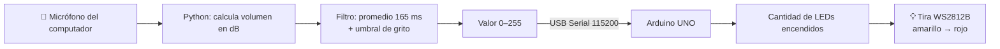

# 🔊 Vúmetro de Gritos

**Sistema interactivo basado en voz** — Entrega 2, Unidad 2: Interfaces Físicas
Diseño de Interfaces · Universidad Adolfo Ibáñez · 2026

Una tira de LEDs que mide la intensidad de los gritos: mientras más fuerte se grita al micrófono, más luces se encienden, pasando de **amarillo intenso a rojo intenso**. La conversación normal y los ruidos cortos (aplausos, golpes) se ignoran: solo un grito sostenido hace reaccionar al sistema.

---

## 🎥 Video

[](https://www.youtube.com/shorts/6EmCK0yLP7w)

👉 **Link:** https://www.youtube.com/shorts/6EmCK0yLP7w

---

## 💡 Concepto

El proyecto convierte algo efímero e invisible —la fuerza de un grito— en una escala luminosa física. Funciona como un "gritómetro": invita a competir, a descargar energía y a ver el propio volumen materializado en luz. Los colores cálidos (amarillo → rojo) refuerzan la sensación de intensidad y alerta a medida que el grito sube.

---

## ⚙️ Cómo funciona



1. **Captura:** un script en Python lee el micrófono del computador en bloques de ~23 ms y calcula el volumen (RMS) en decibeles.
2. **Calibración:** al iniciar, mide 2 segundos de silencio para conocer el ruido ambiente de la sala.
3. **Filtrado:** promedia el volumen de los últimos ~165 ms, así que los sonidos cortos (aplausos, golpes) no alcanzan a encender la tira.
4. **Mapeo:** convierte el volumen a un valor entre 0 y 255 y lo envía al Arduino por USB, 60 veces por segundo.
5. **Salida:** el Arduino enciende de 0 a 6 LEDs según ese valor.

### Regla de mapeo sonido → luz

| Volumen sobre el ruido ambiente | LEDs encendidos | Color |
|---|---|---|
| Menos de +32 dB (hablar, ruido de sala) | 0 | — |
| +32 dB (grito suave) | 1 | 🟡 Amarillo intenso |
| ~ +37 dB | 2 | 🟠 |
| ~ +41 dB | 3 | 🟠 Naranjo |
| ~ +46 dB | 4 | 🟠 |
| ~ +51 dB | 5 | 🔴 |
| +60 dB o más (grito máximo) | 6 | 🔴 Rojo intenso |

La respuesta **sube rápido y baja suave**, por lo que la luz acompaña el grito sin parpadear.

---

## 🧰 Hardware

| Componente | Cantidad | Función |
|---|---|---|
| Arduino UNO | 1 | Controla la tira LED |
| Tira LED direccionable WS2812B (Neopixel) | 6 LEDs | Salida visual |
| Resistencia 330 Ω | 1 | Protege la línea de datos |
| Condensador 1000 µF (opcional) | 1 | Estabiliza la alimentación |
| Fuente externa 5V | 1 | Alimenta la tira sin sobrecargar el Arduino |
| Computador con micrófono | 1 | Entrada de audio y procesamiento |
| Cable USB + cables jumper | — | Conexiones |

---

## 🔌 Diagrama esquemático


| Desde | Hacia |
|---|---|
| Arduino **Pin 6** | Resistencia 330 Ω → **DIN** de la tira |
| Arduino **GND** | **GND** de la tira y **–** de la fuente (tierra común) |
| Fuente **+5V** | **5V** de la tira |
| Computador | Arduino por **USB** (datos + alimentación del Arduino) |

> ⚠️ La tierra (GND) del Arduino, la tira y la fuente debe estar unida; si no, la tira muestra colores erráticos.

---

## 💻 Software

| Archivo | Dónde se usa | Qué hace |
|---|---|---|
| `vumetro_led/vumetro_led.ino` | Arduino IDE | Recibe el valor por Serial y enciende los LEDs |
| `microfono_a_arduino.py` | VS Code / terminal | Escucha el micrófono, calcula el volumen y lo envía al Arduino |

### Instalación y uso

**1. Arduino**
- Instalar la librería **Adafruit NeoPixel** (Herramientas → Administrar bibliotecas).
- Abrir `vumetro_led.ino`, seleccionar *Arduino UNO* y el puerto, y subir el código.
- Cerrar el Monitor Serie (si no, el puerto queda ocupado).

**2. Python** (macOS)
```bash
python3 -m pip install numpy sounddevice pyserial
python3 microfono_a_arduino.py
```
- Guardar silencio 2 segundos mientras calibra.
- ¡Gritar! La terminal muestra los dB y una barra de nivel.
- `Ctrl + C` para detener.

### Parámetros ajustables (`microfono_a_arduino.py`)

| Parámetro | Valor | Efecto |
|---|---|---|
| `MARGEN_DB` | 32 | dB sobre el ambiente para encender el 1er LED. Más alto = menos sensible |
| `RANGO_DB` | 28 | dB extra necesarios para llenar los 6 LEDs |
| `VENTANA` | 10 | Cuadros promediados (~165 ms). Filtra ruidos cortos |
| `SUBIDA` / `BAJADA` | 0.5 / 0.12 | Velocidad de subida y caída de las luces |

---


---
